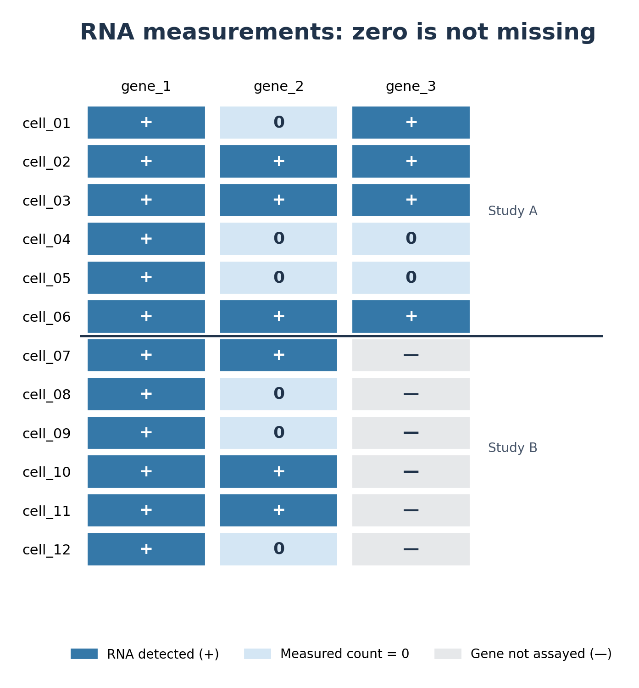
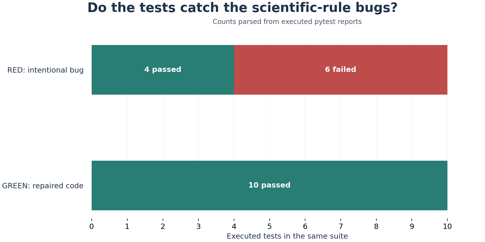

# RNA data-handling checks: reproducible Python analysis

[](https://github.com/dushyant-mishra/scientific-regression-demo/actions/workflows/scientific-regressions.yml)

This repository contains a **reproducible teaching analysis** showing how a functioning Python program can mishandle RNA measurement semantics. Readers can download the data, run the analysis, inspect the outputs and figures, and check exactly which scientific rules the tests enforce.

**Scope:** All RNA observations are **fictional**; `gene_1`–`gene_3` are placeholders. This is a validation of software data-handling rules, **not** a differential-expression study, a biological discovery, or an analysis of JEPA research datasets.

## The analysis question

When combining observations, does the software keep these different states separate?

- **Measured and detected:** the gene was assayed and its RNA count was positive.
- **Measured zero:** the gene was assayed but no RNA was detected in that observation.
- **Unmeasured:** the gene was not included in the assay, so no count exists.

A measured zero cannot be substituted for an unassayed gene. Two further *separate* examples test that repeated row labels do not create extra donor identifiers, and that missing manually assigned study-evidence labels do not silently become a positive verdict.

## Data and design

The [included RNA CSV](data/fictional_rna_observations.csv) has **6 donors**, **12 cells**, **3 genes**, **2 studies**, and **36 gene-by-cell rows**. Each study has three donors and six cells. Study B does not assay `gene_3`.

| Actual included record | Assayed? | Stored count | Correct classification |
| --- | --- | --- | --- |
| Study A · cell_01 · gene_3 | Yes | 4 | `MEASURED_DETECTED` |
| Study A · cell_01 · gene_2 | Yes | 0 | `MEASURED_ZERO` |
| Study B · cell_07 · gene_3 | No | blank | `UNMEASURED` |



*The original data-derived matrix distinguishes detected counts (+), measured zeros (0) and genes that were never assayed (—).*

The **separate two-donor illustration** contains 1,000 repeated row labels representing two distinct donor IDs. It is not part of this CSV, is not an actual resampling experiment, and does not demonstrate statistical independence.

## Run the analysis

Install **Python 3.11 or later**. With Git installed, open a terminal and run:

```bash
git clone https://github.com/dushyant-mishra/scientific-regression-demo.git
cd scientific-regression-demo
python -m pip install -r requirements.txt
python generate_fictional_data.py
python analyze_fictional_rna.py
python -m pytest -q
python run_demo.py
python make_figures.py
```

No Git installation? Use **Code → Download ZIP** on the repository page, extract the files, open a terminal in the extracted directory, and start with the `python -m pip install` command. On systems where Python is called `py` or `python3`, substitute that for `python`.

The scripts regenerate the fixed teaching CSV, classify the records, run the main checks, execute an intentional broken-versus-correct comparison, and rebuild the source-linked charts. For a fully guided first exercise, see [Your first scientific regression test](docs/tutorial/FIRST_TEST_WALKTHROUGH.md).

### What the analysis produces

The [actual summary CSV](outputs/fictional_summary.csv) contains:

| Study | Gene | Detected | Measured zero | Unmeasured |
| --- | --- | ---: | ---: | ---: |
| Study A | gene_1 | 6 | 0 | 0 |
| Study A | gene_2 | 3 | 3 | 0 |
| Study A | gene_3 | 4 | 2 | 0 |
| Study B | gene_1 | 6 | 0 | 0 |
| Study B | gene_2 | 3 | 3 | 0 |
| Study B | gene_3 | 0 | 0 | 6 |

**Interpretation:** Study B contributes **no assay measurements** for `gene_3`. Its six unmeasured entries must not be reported as six observed zeros. The detected/zero totals are properties of the *constructed example*, not estimates of expression differences or biological effects. See [Analysis, results and interpretation](docs/RESULTS_AND_INTERPRETATION.md) for the scientific meaning, other test cases, and limits.

## Verify the software behavior

The main suite checks input validation, cell-to-donor consistency, output integrity, figures, and the stated rules:

```bash
python -m pytest -q
```

The deliberately broken and repaired implementations are compared using **the same ten behavior tests**:

```bash
python run_demo.py
```

Expected comparison from the committed [test receipt](outputs/results.json):

```text
RED: 4 passed, 6 failed, 0 errors    # deliberately incorrect implementation
GREEN: 10 passed, 0 failed, 0 errors # repaired implementation
```



The RED failures are **intentional**. `run_demo.py` reports them while itself finishing successfully. The full main-suite count may increase as tests are added; consult the [current GitHub Actions results](https://github.com/dushyant-mishra/scientific-regression-demo/actions/workflows/scientific-regressions.yml) rather than relying on an old number. Passing these tests does **not** prove biological validity.

## Files to inspect

| Start here | What it contains |
| --- | --- |
| [`data/fictional_rna_observations.csv`](data/fictional_rna_observations.csv) | Input rows and assay flags |
| [`generate_fictional_data.py`](generate_fictional_data.py) | Deterministic teaching-data generator |
| [`analyze_fictional_rna.py`](analyze_fictional_rna.py) | CSV validation, classifications, summaries |
| [`outputs/fictional_summary.csv`](outputs/fictional_summary.csv) and [`outputs/analysis_summary.json`](outputs/analysis_summary.json) | Output counts and dataset summary |
| [`science_rules.py`](science_rules.py) | Scientific software rules |
| [`science_rules_buggy.py`](science_rules_buggy.py) | **Intentionally defective** comparison only; not for analysis |
| [`tests/`](tests/) and [`outputs/results.json`](outputs/results.json) | Automated regression checks and recorded RED/GREEN receipt |
| [`figures/`](figures/) and [Figure methods](docs/FIGURES_AND_METHODS.md) | Source-derived explanatory graphics and how to rebuild them |
| [`docs/RESULTS_AND_INTERPRETATION.md`](docs/RESULTS_AND_INTERPRETATION.md) | Scientific interpretation, separate examples, limitations |

The analysis figures are regenerated from the committed CSV and recorded test results using `make_figures.py`. See [figure methods](docs/FIGURES_AND_METHODS.md).

## Interpretation and reuse

A zero count says **an assay was performed and detected none in that observation**. An unmeasured value says **there is no assay observation**. The distinction matters for downstream analyses, but **no differential expression, disease association, statistical power, causality, or genuine donor independence is estimated here**. The input schema and reader deliberately enforce a fixed 36-row teaching fixture; use the principles and tests as a template rather than applying this script unchanged to a real cohort.

The [short explanatory article](MEDIUM_ARTICLE.md) introduces the intuition. The repository itself is the source for the **data, code, executed results, scientific interpretation, and reproducible figures**.

The code is available under the [MIT license](LICENSE). For reproducibility, cite this repository at **the exact commit used**; see [`CITATION.cff`](CITATION.cff). The separately stored [historical software audit](docs/audit/README.md) is for provenance and does not supersede current code and results.
