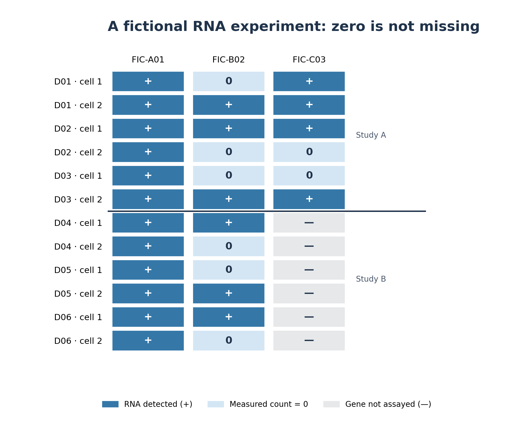
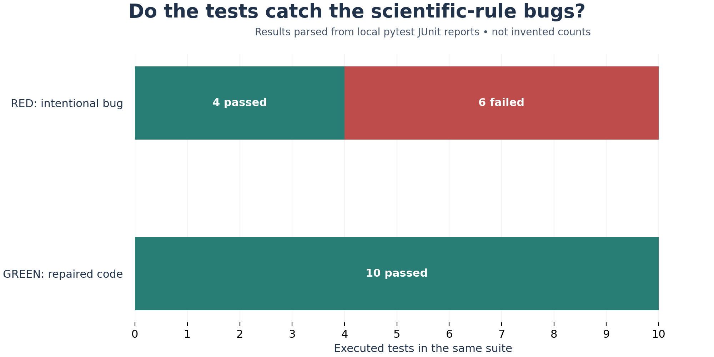
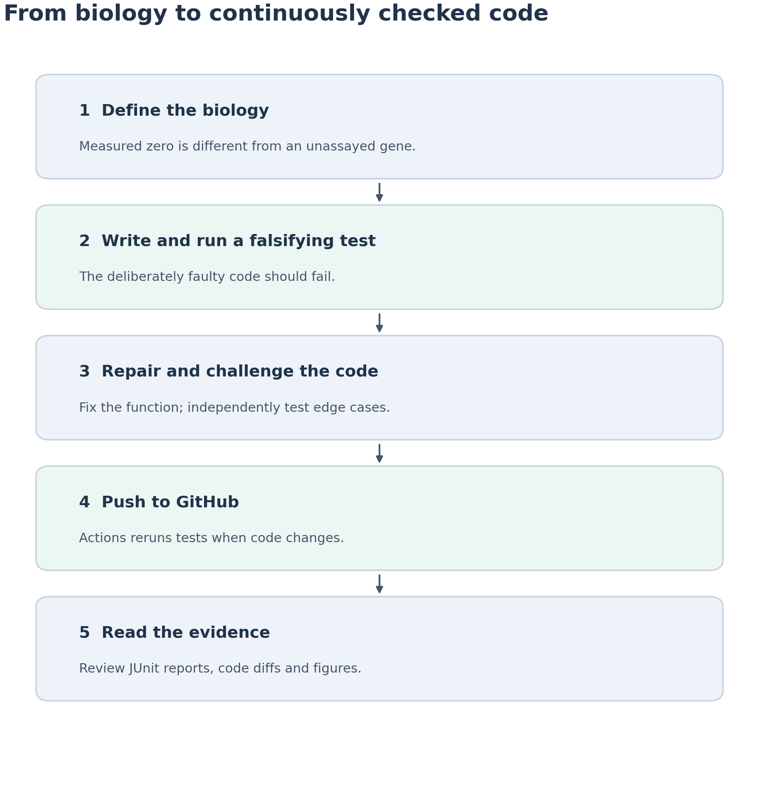
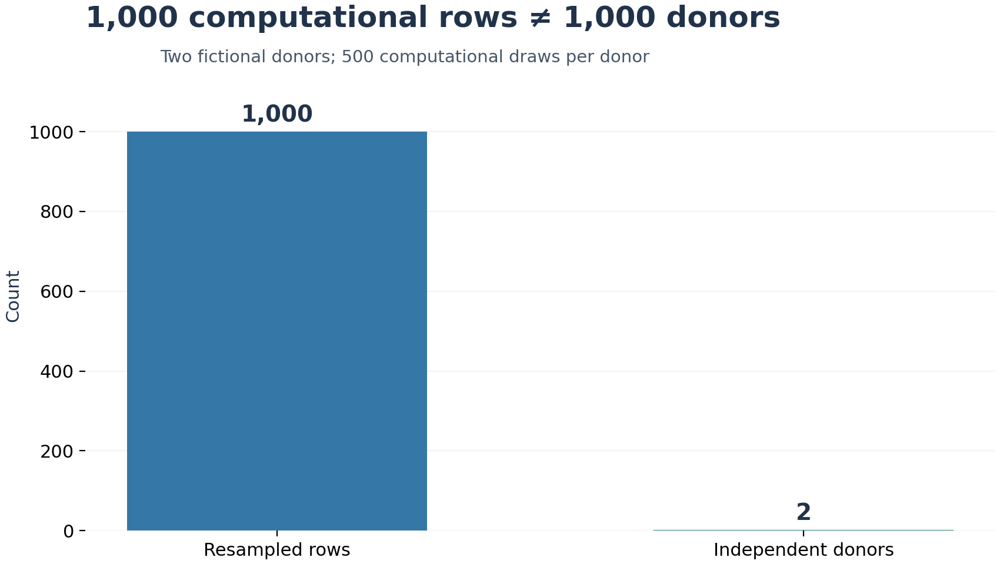

# Scientific regression demo — fictional RNA and GitHub Actions

[](https://github.com/dushyant-mishra/scientific-regression-demo/actions/workflows/scientific-regressions.yml)

This is a **teaching repository**, not an empirical genomics study. It demonstrates how to translate three scientific data-handling rules into Python regression tests, intentionally break those rules (RED), repair them (GREEN), then verify them automatically with GitHub Actions.

**Read the article:** [MEDIUM_ARTICLE.md](MEDIUM_ARTICLE.md) — the article can also be adapted for publication on Medium.

**All genes are fictional:** `FIC-A01`, `FIC-B02`, and `FIC-C03` are invented labels, not genuine gene symbols. All donor, cell, study, and RNA count data are fictional. No identifiable or real biological data are included.

## The imaginary study

- 2 fictional studies, 3 donors per study, 2 cells per donor: **6 donors, 12 cells**.
- 3 invented genes per cell: **36 records** in `data/fictional_rna_observations.csv`.
- Study B does not assay `FIC-C03`; those six cell/gene rows have `assayed=false` and an empty count.
- `FIC-B02` includes genuine *measured zeros* in both studies (within the fictional dataset).

Rules demonstrated: measured zero is not unmeasured; repeated rows are not independent donors; incomplete required evidence cannot be declared PASS.

## Reproduce in a terminal

Python **3.11+** recommended. From a clean checkout:

```bash
git clone https://github.com/dushyant-mishra/scientific-regression-demo.git
cd scientific-regression-demo
python -m pip install -r requirements.txt
python generate_fictional_data.py
python analyze_fictional_rna.py
python -m pytest -q
python run_demo.py
python make_figures.py
```

The `run_demo.py` script deliberately runs one implementation that is *supposed* to fail. The expected RED failure is captured, rather than changing any project files in place. It then executes the **same** tests using the repaired module. The script exits successfully only when the RED tests detect defects and the GREEN tests pass.

### Actual results from local execution

```text
All tests: 17 passed
RED demonstration:  4 passed, 6 failed, 0 errors
GREEN demonstration: 10 passed, 0 failed, 0 errors
```

The numbers above document one local run. They are **not** claimed to be hosted GitHub Actions results. Future runs may differ if the tests change.

`run_demo.py` parses `outputs/red_pytest.xml` and `outputs/green_pytest.xml` using `junit_results.py`; `outputs/results.json` and **Figure 2** are computed from those records, not hard-coded. Reporting tests deliberately mutate XML testcase contents and require the resulting counts to change.

## Figures

| Figure | What it represents |
|---|---|
|  | Actual fictional CSV: detected, measured zero, unmeasured |
|  | Test counts parsed from local JUnit reports |
|  | Scientific rule → RED → repair → CI → review |
|  | Two donor identities despite 1,000 computational draws |

Each chart is available as PNG and SVG; rebuild with `python make_figures.py`.

## Important file map

```text
data/fictional_rna_observations.csv   # fictional gene/cell counts
science_rules.py                      # repaired rules
science_rules_buggy.py                # intentionally defective demo only
analyze_fictional_rna.py             # actual CSV processing
junit_results.py                     # counts testcase nodes from JUnit
run_demo.py                           # runs identical tests twice
make_figures.py                       # figures from saved outputs
outputs/                              # local verification receipts
figures/                              # publication PNG and SVG
.github/workflows/scientific-regressions.yml
CITATION.cff                          # GitHub-compatible citation metadata
MEDIUM_ARTICLE.md                     # complete article
```

## How GitHub Actions helps

GitHub Actions runs on `push`, `pull_request` and manual `workflow_dispatch`. It checks out the target commit, runs the fictional data and tests, reproduces RED/GREEN, creates figures, and uploads saved receipts. Run the same commands locally during development; CI provides a reviewable record for the committed revision. **A green check establishes only that those tests passed, not scientific validity.**

A suggested exercise: fork this repository, create a branch, introduce the `not count` mistake into your fork's `science_rules.py`, open a pull request, inspect the red workflow, then fix it. Do not merge the broken branch.

## Citing this work

GitHub may display **Cite this repository** using [CITATION.cff](CITATION.cff). To make the citation unambiguous, include the repository's **commit SHA** (and optionally the date accessed):

> dushyant-mishra. (2026). *Scientific Regression Demo: Fictional RNA Data, Regression Tests, and GitHub Actions* [Software and teaching materials]. GitHub. https://github.com/dushyant-mishra/scientific-regression-demo (commit `<COMMIT_SHA>`).

No DOI is claimed. If an archival DOI is later minted for a particular release, update the citation for that release. You may cite the Medium article separately by its final URL and publication date.

## Scope and limitations

- This is not differential-expression testing, causal inference, biological validation or a real donor study.
- The toy evidence-decision precedence rule is explicitly illustrative, not a universal way to pool studies.
- Counting distinct donor IDs does not replace proper replication-aware inference or provenance checking.
- RED is a deliberately faulty fixture, not a recommended analysis method.
- Local test results have been verified; check Actions for the *current hosted* CI status.

## License

Code, fictional data and documentation are released under the [MIT License](LICENSE). Citation is appreciated when reusing the work.
